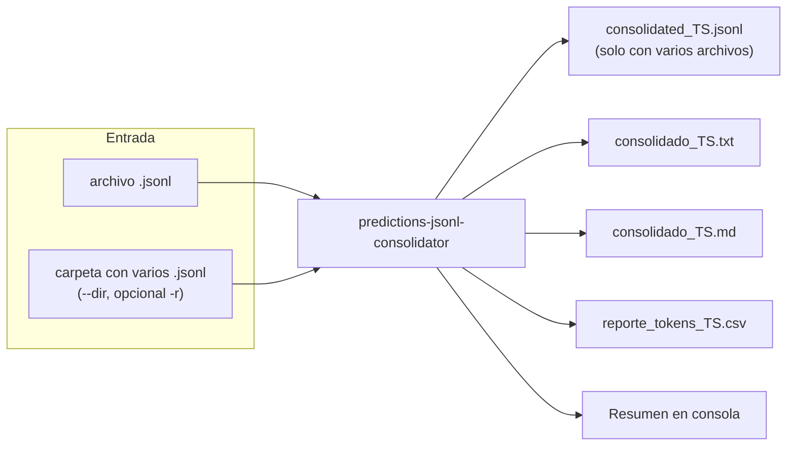
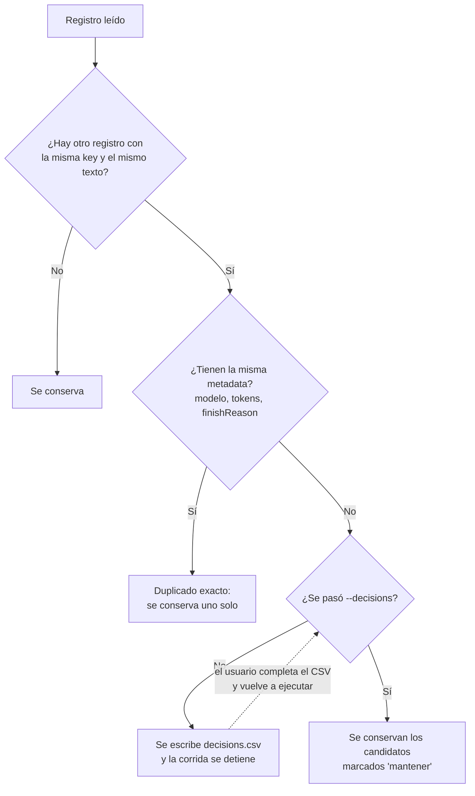
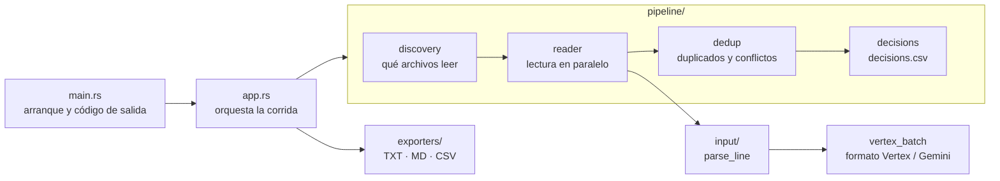

# Predictions JSONL Consolidator

Herramienta de línea de comandos en Rust que convierte los resultados de **predicciones
batch de Gemini / Vertex AI** (archivos `.jsonl`) en documentos fáciles de leer y en un
reporte de uso de tokens.

Fue pensada para procesos de OCR en batch: cada línea del JSONL es la transcripción de una
imagen. La herramienta junta todas las respuestas, elimina duplicados, las ordena y genera:

- un **TXT** y un **Markdown** con todos los textos, ordenados por `key`;
- un **CSV** con el modelo, los tokens consumidos y el motivo de fin de cada respuesta;
- un **JSONL consolidado** cuando se combinan varios archivos.



## Contenido

- [Inicio rápido](#inicio-rápido)
- [Uso](#uso)
- [Qué genera](#qué-genera)
- [Formato de entrada](#formato-de-entrada)
- [Duplicados y conflictos](#duplicados-y-conflictos)
- [Errores y códigos de salida](#errores-y-códigos-de-salida)
- [Datos de ejemplo](#datos-de-ejemplo)
- [Arquitectura](#arquitectura)
- [Desarrollo](#desarrollo)

## Inicio rápido

Requisito: [Rust](https://rustup.rs/) 1.85 o superior (el proyecto usa la edición 2024).

```powershell
# Compilar
cargo build --release

# Procesar el ejemplo incluido en el repositorio
cargo run --release -- data/example/input/predictions.jsonl
```

Los reportes quedan en `data/example/input/jsonl_extract/`, y en la consola se imprime un
resumen. El binario compilado está en `target/release/predictions-jsonl-consolidator.exe`
(sin `.exe` fuera de Windows).

## Uso

```text
predictions-jsonl-consolidator [OPCIONES] [ARCHIVO]
```

Hay tres formas de indicar la entrada:

| Modo | Comando | Qué procesa |
| :--- | :--- | :--- |
| Archivo | `predictions-jsonl-consolidator datos.jsonl` | Un solo archivo |
| Carpeta | `predictions-jsonl-consolidator --dir carpeta` | Todos los `.jsonl` de la carpeta (con `-r`, también los de subcarpetas) |
| Automático | `predictions-jsonl-consolidator` | La carpeta actual, como `--dir .` |

El modo automático está pensado para abrir el ejecutable con doble click. En Windows, al
terminar, espera a que se presione Enter para que la ventana no se cierre antes de leer el
resultado.

En modo carpeta se ignoran los archivos `consolidated_*.jsonl` (resultados de corridas
anteriores) y los archivos se leen en orden natural de nombre.

### Opciones

| Opción | Descripción | Por defecto |
| :--- | :--- | :--- |
| `ARCHIVO` | Archivo `.jsonl` de entrada. No se puede combinar con `--dir`. | — |
| `-d`, `--dir <DIR>` | Carpeta con los archivos `.jsonl` a consolidar. | — |
| `-r`, `--recursive` | Busca también en subcarpetas (con `--dir` o en modo automático). | Solo el primer nivel |
| `--out-txt <RUTA>` | Ruta del TXT. | `jsonl_extract/consolidado_TS.txt` |
| `--out-md <RUTA>` | Ruta del Markdown. | `jsonl_extract/consolidado_TS.md` |
| `--out-csv <RUTA>` | Ruta del CSV de tokens. | `jsonl_extract/reporte_tokens_TS.csv` |
| `--decisions <RUTA>` | `decisions.csv` ya completado, para resolver conflictos (ver [Duplicados y conflictos](#duplicados-y-conflictos)). | — |
| `--no-keys` | Omite el separador `=== key ===` antes de cada texto del TXT. | Con separadores |
| `-v`, `--verbose` | Diagnóstico detallado: tiempo por archivo y líneas por segundo. | — |
| `-q`, `--quiet` | Oculta la barra de progreso y el diagnóstico; el resumen y los errores se siguen mostrando. | — |
| `-h`, `--help` / `-V`, `--version` | Ayuda / versión. | — |

`TS` es la fecha y hora de la corrida (`YYYYMMDD_HHMMSS`), así que una corrida nueva nunca
sobrescribe a la anterior. `jsonl_extract/` se crea junto al archivo de entrada o dentro
de la carpeta procesada. Si se indican rutas propias con `--out-*`, las carpetas que falten
se crean solas. `--verbose` y `--quiet` no se pueden usar juntos, y la variable de entorno
`RUST_LOG`, si está definida, tiene prioridad sobre ambos.

### Ejemplos

```powershell
# Un archivo, con los reportes en jsonl_extract/ junto a él
predictions-jsonl-consolidator resultados.jsonl

# Todos los .jsonl de una carpeta y sus subcarpetas
predictions-jsonl-consolidator --dir resultados -r

# Rutas de salida propias y TXT sin separadores
predictions-jsonl-consolidator resultados.jsonl --out-txt texto.txt --out-md texto.md --out-csv tokens.csv --no-keys
```

## Qué genera

| Archivo | Contenido |
| :--- | :--- |
| `consolidated_TS.jsonl` | Las líneas originales que quedaron después de deduplicar, ordenadas por `key`. Solo se genera al combinar varios archivos. |
| `consolidado_TS.txt` | Texto plano: cada respuesta precedida por `=== key ===`. |
| `consolidado_TS.md` | Markdown con un encabezado `## Clave: key` por respuesta, cómodo para revisar. |
| `reporte_tokens_TS.csv` | Una fila por respuesta con el modelo y los tokens (columnas abajo). |

Todo se ordena por `key` en **orden natural**: `item-2` va antes que `item-10`. Las
respuestas sin texto (por ejemplo, cortadas por `MAX_TOKENS`) aparecen como `...` en el TXT
y el MD, y el motivo queda en la columna `Finish Reason` del CSV.

### Columnas del CSV

| Columna | Descripción |
| :--- | :--- |
| `key` | Identificador de la predicción. |
| `model` | Versión del modelo (vacío si la línea no lo trae). |
| `Traffic Type` | Tipo de tráfico tal como lo informa la API, por ejemplo `ON_DEMAND`. |
| `Prompt Image Tokens` | Tokens de imágenes en el prompt. |
| `Prompt Text Tokens` | Tokens de texto en el prompt. |
| `Prompt Other Tokens` | Tokens de otras modalidades del prompt (audio, video, documentos). |
| `Prompt Tokens` | Total de tokens del prompt. |
| `Candidate Tokens` | Tokens de la respuesta. |
| `Thoughts Tokens` | Tokens de razonamiento interno, si el modelo los usa. |
| `Total Tokens` | Total de la predicción. |
| `Finish Reason` | Motivo de fin de la respuesta, por ejemplo `STOP` o `MAX_TOKENS`. |

### Resumen en consola

Al terminar se imprime un resumen como este (procesando `data/example/input/`):

```text
Resumen:
  Archivos leídos:            2
  Archivos ilegibles:         0
  Líneas procesadas:          142
  Líneas con error de parseo: 0
  Predicciones fallidas:      0
  Duplicados eliminados:      2
  Registros sin texto:        6
  Archivos generados:
    - carpeta\consolidated_20261022_192531.jsonl
    - carpeta\jsonl_extract\consolidado_20261022_192531.txt
    - carpeta\jsonl_extract\consolidado_20261022_192531.md
    - carpeta\jsonl_extract\reporte_tokens_20261022_192531.csv
```

"Líneas procesadas" es la cantidad de registros que llegaron a los reportes, ya sin
duplicados. Cada registro sin texto, cada línea con error y cada predicción fallida también
se informa en el log con su `key` o su número de línea.

## Formato de entrada

Cada línea es una predicción del batch de Vertex AI / Gemini. Estos son los campos que usa
la herramienta (`request`, `processed_time` y el resto se ignoran):

```json
{
  "key": "P0002_[c02]_[003].png",
  "status": "",
  "response": {
    "modelVersion": "gemini-3-flash-preview",
    "candidates": [
      { "content": { "parts": [{ "text": "I. Domesticación inicial de camélidos..." }] },
        "finishReason": "STOP" }
    ],
    "usageMetadata": {
      "promptTokenCount": 1598,
      "promptTokensDetails": [
        { "modality": "IMAGE", "tokenCount": 1092 },
        { "modality": "TEXT", "tokenCount": 506 }
      ],
      "candidatesTokenCount": 554,
      "thoughtsTokenCount": 2575,
      "totalTokenCount": 4727,
      "trafficType": "ON_DEMAND"
    }
  }
}
```

El lector es tolerante a cambios de formato:

- **Solo `key` es obligatorio.** Si faltan `modelVersion`, `usageMetadata` u otros datos de
  metadata, la línea se conserva y esas columnas quedan vacías o en cero.
- **El texto** es la concatenación de las partes de texto del primer candidato. Las partes
  de razonamiento (`"thought": true`) no se incluyen.
- **Predicciones fallidas:** si `status` trae un mensaje de error, la línea se cuenta en
  "Predicciones fallidas" y no como línea malformada.
- **Si ninguna línea se puede leer**, casi siempre es porque cambió el formato. La
  herramienta se detiene sin generar reportes vacíos y muestra el motivo, por ejemplo
  `missing field `key``, con el archivo y el número de línea.

## Duplicados y conflictos

Es habitual que la misma imagen se procese más de una vez (reintentos, varios batches).
La herramienta resuelve sola los casos sin ambigüedad y pide una decisión en los demás:



- **Duplicado exacto:** misma `key`, mismo texto y misma metadata. Se conserva uno y se
  cuenta en "Duplicados eliminados". Los campos que cambian en cada reintento (`responseId`,
  `createTime`, `processed_time`, la URI de la imagen) no se comparan.
- **Conflicto:** misma `key` y mismo texto, pero distinta metadata (por ejemplo, otro modelo
  u otro conteo de tokens). La herramienta no elige por su cuenta:
  1. Escribe `decisions.csv` con una fila por candidato: `key`, `candidate_id`, archivo de
     origen, modelo, tokens, vista previa del texto y una columna `decision` vacía. Lo deja en
     la carpeta procesada o, si se usó `--out-csv`, junto a ese CSV.
  2. Se detiene sin generar reportes.
  3. Complete la columna `decision` con `mantener` (se puede marcar más de un candidato por
     `key`) o con `ignorar`, o déjela vacía para descartar.
  4. Vuelva a ejecutar el mismo comando agregando `--decisions decisions.csv`.

Los candidatos descartados así se cuentan aparte, en "Descartados por decisión". El
`candidate_id` depende solo de la key, el texto y la metadata, así que sigue siendo válido
aunque en la segunda corrida cambie el orden o el nombre de los archivos.

Dos registros con la misma `key` pero **distinto texto** no son duplicados: se conservan
los dos.

## Errores y códigos de salida

| Situación | Qué hace | Código |
| :--- | :--- | :---: |
| Todo correcto | Genera los archivos e imprime el resumen. | 0 |
| Algunas líneas no se pueden leer | Las informa con su número de línea, las cuenta en "Líneas con error de parseo" y sigue con el resto. | 0 |
| Predicciones con `status` de error | Las informa y las cuenta en "Predicciones fallidas". | 0 |
| Un archivo no se puede abrir o leer | Procesa los demás, genera los reportes y avisa que pueden estar incompletos. | 1 |
| Ninguna línea es válida | Se detiene sin generar reportes y muestra el primer error. | 1 |
| Hay conflictos sin `--decisions` | Escribe `decisions.csv` y se detiene. | 1 |
| `decisions.csv` deja alguna key sin ningún `mantener` | Indica qué keys faltan y se detiene. | 1 |
| La carpeta no tiene archivos `.jsonl` | Se detiene con un mensaje. | 1 |

## Datos de ejemplo

`data/example/` permite ver qué genera la herramienta sin ejecutarla:

- `input/`: archivos JSONL de ejemplo. `predictions.jsonl` tiene datos reales de un batch
  de OCR con Gemini (incluye 2 predicciones repetidas por reintentos y 3 respuestas cortadas por `MAX_TOKENS`).
- `output/`: lo que genera la herramienta para cada entrada, con nombres fijos:
  `<nombre>.txt`, `<nombre>.md` y `<nombre>_tokens.csv`.

Un test (`example_outputs_are_up_to_date`) comprueba que estas salidas coinciden byte a
byte con lo que genera el código actual, así que siempre están al día. Ver
[Desarrollo](#desarrollo) para regenerarlas.

## Arquitectura



| Módulo | Responsabilidad |
| :--- | :--- |
| `main.rs` | Lee los argumentos, configura el log, hace la pausa del modo automático y define el código de salida. |
| `app.rs` | Ejecuta una corrida: resuelve la entrada, llama al pipeline, escribe el consolidado y los reportes, e imprime el resumen. |
| `input/` | Único lugar que conoce el formato del JSONL. Convierte cada línea en un `Record` o en una predicción fallida. |
| `pipeline/` | Busca los archivos, los lee en paralelo, deduplica y aplica `decisions.csv`. No escribe archivos. |
| `models.rs` | Tipos compartidos: `Record` (key, texto y uso) y `Usage` (modelo y tokens). |
| `exporters/` | Genera el TXT, el MD y el CSV. Aquí se decide la presentación: el marcador `...` y las columnas del CSV. |

**Si el formato del JSONL cambia**, el ajuste se hace en `src/input/vertex_batch.rs`.
Para soportar un formato distinto, se agrega otro adaptador en `src/input/` y se elige
desde `parse_line`; el resto del programa no cambia. Las columnas del CSV se definen solo en
`src/exporters/csv.rs` y cambiarlas no afecta la detección de duplicados.

```text
src/
├── main.rs, app.rs, cli.rs, errors.rs, models.rs
├── input/        mod.rs, vertex_batch.rs
├── pipeline/     mod.rs, discovery.rs, reader.rs, dedup.rs, decisions.rs
└── exporters/    mod.rs, txt.rs, md.rs, csv.rs
tests/
├── cli.rs        tests de integración (ejecutan el binario)
└── common/       constructores de líneas JSONL para los tests
data/example/     ejemplos de entrada y sus salidas
docs/upgrade/     registro de las mejoras realizadas
```

## Desarrollo

```powershell
cargo test                                   # tests unitarios y de integración
cargo fmt --check                            # formato
cargo clippy --all-targets -- -D warnings    # lint
```

- **Tests unitarios:** el formato de entrada (`src/input/vertex_batch.rs`, que además
  comprueba que todos los fixtures del repo se lean sin errores) y las etapas del pipeline.
- **Tests de integración** (`tests/cli.rs`): ejecutan el binario real sobre archivos
  temporales y cubren los modos de entrada, la deduplicación, el flujo de `--decisions`, los
  errores y los códigos de salida. Las líneas JSONL se construyen en `tests/common/mod.rs`
  con `serde_json::json!`, así que si el formato cambia se ajustan en un solo lugar.

**Regenerar las salidas de ejemplo** después de un cambio intencional en la salida (y
revisar el diff antes de hacer el commit):

```powershell
$env:UPDATE_EXAMPLES=1; cargo test --test cli example_outputs; Remove-Item Env:UPDATE_EXAMPLES
```

Para agregar un ejemplo nuevo, se copia el `.jsonl` a `data/example/input/` y se regenera.
`data/example/output/` está marcado como binario en `.gitattributes`: así git no cambia sus
finales de línea en Windows y la comparación byte a byte sigue funcionando.

El historial de decisiones de diseño y mejoras está en
[`docs/upgrade/tasks-v1.md`](docs/upgrade/tasks-v1.md).

---

Proyecto desarrollado como experimento de aprendizaje en Rust.
